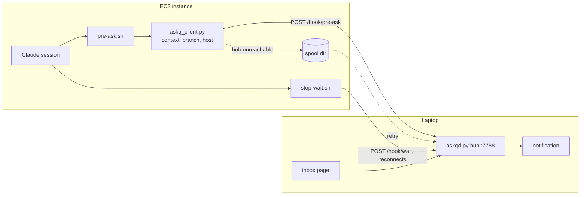

# ask-queue-remote

**Status:** building
**Branch/PR:** —

## Goal

Claude sessions on other tailnet machines (first: the EC2 instance) send their `AskUserQuestion` calls to the laptop's ask-queue daemon on port 7788. The user keeps one inbox and one set of desktop notifications, whatever machine a session runs on. Answers wake the remote session the same way they wake a local one.

## Definition of Done

- [ ] An `AskUserQuestion` call in an EC2 session appears in the laptop inbox, with a host chip, the repo, the branch, and the session context. — _evidence: screenshot_
- [ ] The laptop shows a desktop notification for the EC2 question. — _evidence: user confirmation_
- [ ] An answer given in the laptop inbox wakes the EC2 session, and the session continues. — _evidence: command (EC2 transcript excerpt)_
- [ ] A question asked while the laptop is asleep or offline reaches the inbox when the laptop is back, and its answer still wakes the session. — _evidence: command (timestamps + transcript excerpt)_
- [ ] `/hook/*` on the tailnet listener accepts only peers owned by the same Tailscale user as the hub; any other peer gets 403. — _evidence: test (whois lookup stubbed for a foreign user)_
- [ ] Laptop-only use works as before, with no configuration. — _evidence: command (local session excerpt)_
- [ ] EC2 setup is documented in `CLAUDE.md` in at most 5 steps. — _evidence: pointer_

## Open Questions

| Question | Status | Answer/decision |
|----------|--------|-----------------|
| If the laptop is unreachable when an EC2 session asks: spool on EC2 and forward later (recommended), fall back to the native picker, or block until reachable? | answered | Spool |
| Hub location: the laptop (as asked), or the always-on EC2 instance with the laptop only showing notifications? | answered | Laptop |
| Auth for remote `/hook/*` calls: a shared token (recommended), or `tailscale whois` on the peer IP? | answered, then revised | No token. Rely on Tailscale: `tailscale whois` must report the same user as the hub. |
| Is the EC2 instance on Amazon Linux or Ubuntu? Is `python3` there 3.9 or newer? | answered (checked over SSH) | Ubuntu 24.04, Python 3.12.3, curl 8.5.0, Claude Code in `~/.local/bin`. It reaches the laptop hub over the tailnet (`/health` 200). |

## Design

Today's design has three things that assume one machine:

1. Hooks call `127.0.0.1:7788`.
2. `/hook/*` answers on loopback only.
3. The daemon reads `transcript_path` and runs `git -C <cwd>` to build the context and branch. On EC2, those paths exist only on EC2.

The plan changes each one:

- **Client-side enrichment.** A new `server/askq_client.py` runs on the machine that has the session. It reads the hook input, adds `context` (from `transcript_path`), `branch` (from `git -C cwd`), and `host` (the Tailscale `HostName` from `tailscale status --self --json`, else `hostname -s`; on EC2 `hostname -s` gives an `ip-10-...` name, which is useless), then posts the result. The daemon uses fields it receives and computes them only when they are missing. Local mode uses the same client, so there is one code path.
- **Hub configuration.** `~/.claude/ask-queue/hub` holds the hub URL, for example `http://<laptop MagicDNS name>:7788`. If the file exists, the hooks never start a local daemon, and they talk to the hub. If it is absent, the behavior stays as it is today. A file, not an env var, because hook processes do not get the shell's env in every launch path, and a file survives plugin reinstalls.
- **Auth.** No token. Tailscale already authenticates every device that can reach the tailnet address. For `/hook/*` on the tailnet listener, the hub runs `tailscale whois <peer IP>` (cached per IP) and accepts only peers whose user matches the hub's own user. Today the tailnet has one user and no shared-in nodes, so this check only matters if a node is shared later. `/api/*` and the page stay open on the tailnet, as today. Loopback stays open.
- **Long-poll over the network.** The server returns `202` every 10 minutes with no answer. On `202`, the client polls again at once. On a connection error, it retries with backoff (5 s, then up to 60 s) until the 24 h limit. `204` still means "nothing queued, stop". This keeps idle TCP connections short and survives laptop sleep and Wi-Fi changes.
- **Spool for an unreachable hub.** If `POST /hook/pre-ask` fails, the client writes the payload to `~/.claude/ask-queue/spool/` and returns the same `deny` with an ID of the form `Q-pending-<n>`. The `Stop` hook first flushes the spool, then waits. The hub gives the real `Q-<id>` when the question arrives. The session only sees the answer, so the ID change does not matter to it.
- **UI.** Each card shows a host chip next to the repo chip.

Why the hub stays on the laptop for now: Mac notifications must come from the laptop, and the page is already reachable from every tailnet device. An EC2 hub would be online more often, but it would need a separate notifier on the laptop. If laptop sleep turns out to be a frequent problem, the hub can move later, and the client design does not change.

## Decisions

- Spool on EC2 when the hub is unreachable. — No one watches the EC2 terminal, so the native picker fallback would leave the session stuck unseen.
- The hub stays on the laptop. — Mac notifications must come from the laptop. The client design allows moving the hub later.
- ~~Shared bearer token for `/hook/*` on the tailnet listener.~~ Replaced: rely on Tailscale, with a `tailscale whois` same-user check. — Tailscale already authenticates the devices, the tailnet has one user, and this needs no token copied between machines.
- DoD accepted by the user (2026-10-21).
- No more scripted local tests; verify in real use through `ask-queue.log`. — A test cleanup command (`pkill -f` with extra arguments) killed unrelated processes on 2026-10-21, including the user's browser, Claude sessions, and the podman runtime. The user asked for logging instead (2026-10-21).
- Use one shared client script (`askq_client.py`) for local and remote modes. — One code path to test, and the daemon no longer depends on the session's filesystem.

## Tasks

- [x] Check the OS and `python3` version on EC2
- [x] `askq_client.py`: enrich and post; daemon accepts precomputed fields
- [x] Hub config file + `tailscale whois` same-user check on the tailnet listener
- [x] Long-poll `202` re-poll + reconnect backoff in `stop-wait.sh`
- [x] Spool + flush
- [x] Host chip in the inbox
- [x] EC2 install: `/plugin marketplace add sharatvisweswara/plugboard`, `/plugin install ask-queue@plugboard`, write the `hub` file
- [x] `CLAUDE.md` setup steps (ask-queue section, "Remote sessions")
- [x] Event log at `<state>/ask-queue.log` from the client, the hooks, and the daemon (every outcome, hub errors, fallbacks, tracebacks)

## Out of Scope

- More than one hub, or hubs syncing with each other
- Phone push notifications (the page already works on the phone over the tailnet)
- Access control per tailnet user (one-person tailnet assumed)
