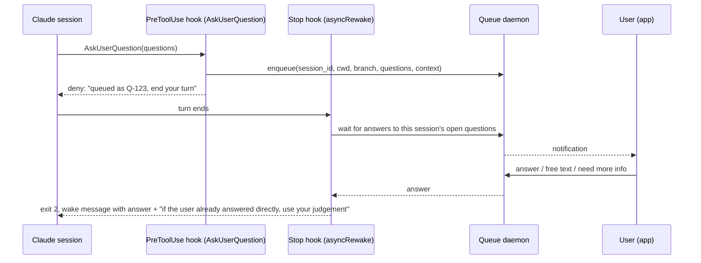
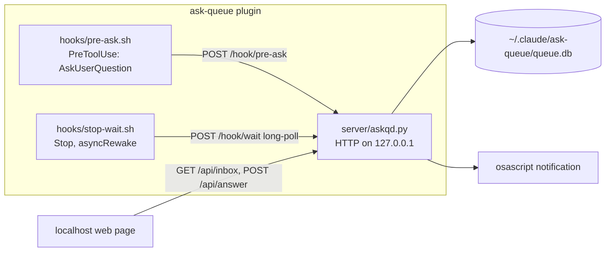
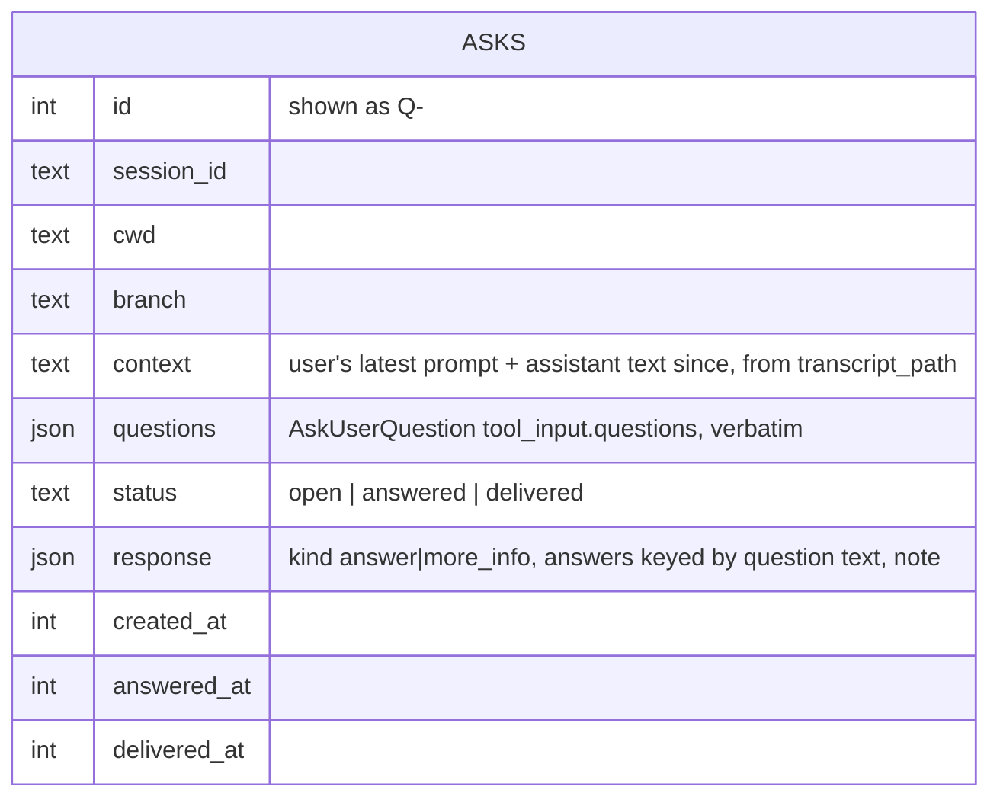

# ask-queue

**Status:** building
**Branch/PR:** —

## Goal

Questions from many parallel Claude Code sessions (`AskUserQuestion` calls) go into one queue instead of waiting unseen in individual terminals. The user gets a notification for each new question. The user answers questions one at a time from a single app: pick an option, type free text, or ask for more information. A session that waits hours for an answer must survive the wait and continue when the answer arrives.

## Definition of Done

- [ ] An `AskUserQuestion` call in any session with the plugin installed appears in the queue app, with repo, branch, and recent context. — _evidence: screenshot_
- [x] A notification fires when a new question enters the queue. — _evidence: screenshot_
    No screenshot. The user confirmed by eye on 2026-10-21: notifications appear for each new question, and with `terminal-notifier` installed, a click opens the inbox (Q-8). The Undo countdown was also confirmed (Q-7).
- [ ] Choosing an option in the app delivers the answer to the session, and the session continues. — _evidence: command (transcript excerpt)_
    Live session (Haiku, `--plugin-dir`), answer posted to `/api/answer`, not yet clicked in the page:
    ```
    ⎿ Error: PreToolUse:AskUserQuestion hook error: Your question was queued as Q-4 …
    ⏺ … Questions sent via AskUserQuestion, queued as Q-4 in your ask-queue inbox.
    $ curl -X POST …/api/answer -d '{"id":4,"kind":"answer","answers":{…:"Python",…:"Date"}}'
    ⏺ Bash(python3 …/e2e/hello.py) ⎿ 2026-10-21
    ⏺ Answers came through the ask-queue notification (Q-4): Python, Date.
    ```
    User click in the inbox page (Q-5, "Yes"): answered 13:47:56, delivered 13:47:56, and the session added the shebang.
- [x] Free-text answers reach the session the same way. — _evidence: command (transcript excerpt)_
    User typed "maybe" in "Other" for Q-6 (answered and delivered 13:58:41):
    ```
    ⏺ ask-queue answer
    ⏺ Q-6 came back with "maybe". That is not one of the two options (greet.py, today.py), so no name chosen.
      🔴 Reply with greet.py, today.py, or a different name for hello.py.
    ```
    Follow-up: the session asked for clarification in plain text, which never reaches the inbox. The wake footer now tells it to use AskUserQuestion. Confirmed: after the Q-8 answer, the session queued its follow-up as Q-9 through AskUserQuestion.
- [x] "Request more info" makes the session re-ask with more context, and the new question enters the queue. — _evidence: command (transcript excerpt)_
    The user clicked "Need more info" on Q-9 with the note "what exactly is it running?" (delivered 14:03:23):
    ```
    ⏺ ask-queue answer
      ⎿ … queued as Q-10 in the user's ask-queue inbox …
    ⏺ today.py prints today's date (YYYY-MM-DD) to stdout, then exits. Cron output goes to mail unless redirected.
      Re-asked as Q-10 with that context.
    ```
    The user received Q-10 in the inbox.
- [ ] A question left unanswered for at least 1 hour still delivers its answer when the user answers it. — _evidence: command (timestamps + transcript excerpt)_
- [x] The plugin is registered in `.claude-plugin/marketplace.json` and installs with `/plugin install ask-queue@plugboard`. — _evidence: pointer_
    Registered: `.claude-plugin/marketplace.json`. Installed from the marketplace by the user: a marvin2 session queued Q-3 into the host daemon (`~/.claude/ask-queue/queue.db`, port 7788), which runs from `/Users/sharat/Projects/plugboard/plugins/ask-queue/server/askqd.py`.

## Open Questions

| Question | Status | Answer/decision |
|----------|--------|-----------------|
| Can a blocking `PreToolUse` hook wait for hours (is `timeout` capped)? | 15 min: yes. 2 h: running | `timeout: 10800` honored past 15 min; tool then ran normally. Blocking stays a fallback only. |
| Does a `Stop` hook with `asyncRewake: true` wake an idle interactive session after a long wait? | answered: yes | Both the 2-min and the 1-h run woke the idle session, and the stderr reached the model word for word (evidence under Tasks) |
| Wake policy: wake the session on the first answer, or only when all its open questions are answered? | answered | First answer |
| Does `asyncRewake` survive a backgrounded terminal and Mac sleep? | open — spike 2b, not blocking for the proof of concept | |
| UI: localhost web page or native menu bar app? | answered | Localhost web page |
| Notifications: desktop only, or phone too (ntfy)? | answered | Desktop only |

## Design

Flow (async):



Components and data:





Constraints:

- If the daemon is not running, `pre-ask.sh` starts it. If the start fails, the hook exits with no output, so the native picker shows as usual.
- One `asks` row per `AskUserQuestion` call (1–4 questions). The app answers the whole call at once.
- The state lives in `~/.claude/ask-queue/`, outside the plugin, so it survives reinstalls. This matches `comms`.

## Decisions

- Ship as a plugin (hook + bundled queue app), not an MCP-only server. — Hooks catch the native `AskUserQuestion` call, so no model behavior has to change. An MCP tool depends on the model picking it over the native one.
- Batching: a queued question does not stop the session. The deny reason tells the session to keep working on anything independent and to queue more independent questions. The session ends its turn only when it is blocked on answers. Dependent questions get asked after the wake. — Overnight runs fill the inbox with every question at once, not one per answer cycle.
- Wake on the first answer. The `Stop` hook re-arms at every turn end. If answers arrived while the session was busy, the next `Stop` hook returns them at once. — The session continues as soon as anything unblocks it.
- First version is a proof of concept: localhost web page, desktop notifications only. — Prove the flow before more UI and notification work.
- Definition of Done accepted by the user (2026-10-21).
- Daemon in Python 3 standard library only (`http.server`, `sqlite3`). Hooks stay POSIX `sh` + `curl`. — POSIX `sh` cannot serve HTTP or long-poll. Python 3 needs no install step on macOS developer machines. Confirmed by the user.
- Answers wait 5 s in the page with an Undo button before they are sent. — The user misclicked "Yes" on Q-5, and a delivered answer cannot be taken back.
- Notifications use `terminal-notifier -open <inbox>` when it is installed, else `osascript`. — With `osascript`, a click on the notification opens Script Editor instead of the inbox.
- The daemon also listens on the tailnet address when Tailscale is up; `/hook/*` answers on loopback only (403 elsewhere). — The user wants the inbox on their phone. Keeping the hooks on loopback means other tailnet devices can read and answer questions but cannot inject them.
- Phone access over the tailnet confirmed by the user (2026-10-21).
- Direct replies typed into a session do not cancel queued questions. The queued answer's wake message tells the session to use its judgement if the user already answered directly. — No cancel logic is needed.

## Tasks

- [ ] Spike 1: blocking `PreToolUse` hook with a large `timeout` (15 min passed; 2 h running)
    ```
    hook log: start 13:10:36, end 13:25:36 (no kill)
    session:  ⏺ Bash(echo spike1) ⎿ spike1 · Worked for 15m 7s
    ```
- [x] Spike 2: `Stop` hook with `asyncRewake` waking an idle session (2 min and 1 h passed)
    ```
    hook log: start 13:11:49, end 13:13:49 (exit 2)
    session:  ⏺ ready / ⏺ spike answer / ⏺ SPIKE-ANSWER-s2-2m: the user picked option B
    1 h run: start 13:11:48, end 14:11:48 (exit 2)
    session:  ⏺ ready / ⏺ spike answer / ⏺ SPIKE-ANSWER-s2-1h: the user picked option B · done 2:11 PM
    ```
- [ ] Spike 2b: `asyncRewake` with backgrounded terminal and Mac sleep (needs user)
- [x] Pick blocking vs async flow from spike results (async)
- [x] Queue daemon + storage (`plugins/ask-queue/server/askqd.py`; curl tests: queue, answer, more_info, superseded waiter, redelivery after killed hook)
- [x] Hooks (`hooks/pre-ask.sh`, `hooks/stop-wait.sh`)
- [x] App UI + notifications (user click-through of option, free text, more info, and Undo; notification click opens the inbox)
- [x] Marketplace registration
- [x] `CLAUDE.md` plugin section

## Out of Scope

Proof of concept only. These come after the concept works:

- Native menu bar app
- Phone notifications (ntfy or similar)
- Queuing permission prompts
- Marking questions as "maybe answered directly" when the user types into a session
- A "dismiss" action for questions whose session is gone (Q-10 showed the need: its session was stopped, and the question has no way out of the inbox)
